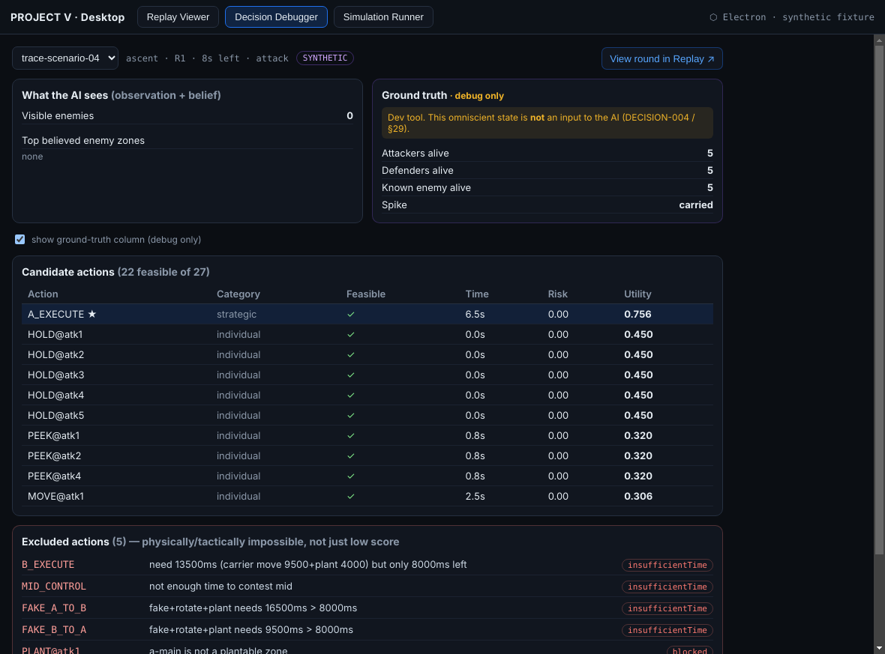
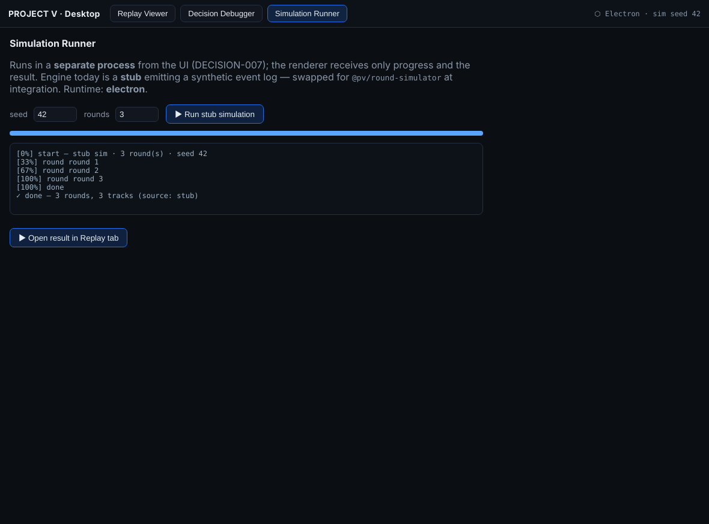

# @pv/desktop

PROJECT V desktop shell (Electron + Vite + React + TypeScript, DECISION-007).
Three screens behind a tab bar:

| Screen | What it does |
|---|---|
| **Replay Viewer** | Reuses the shared `@pv/replay-viewer` `<ReplayViewer>` (not copy-pasted) to play decoded `.vrf` and simulated replays. Open / drag a replay JSON. |
| **Decision Debugger** | Renders a PV-3 `DecisionTrace` (Handoff §21): observation/belief vs ground-truth (clearly separated, truth is a **debug-only** view, not an AI input), candidate actions with computed Feasibility/Time/Risk/Utility, **excluded actions + reasons**, and the selected action + rationale. "View round in Replay ↗" cross-links. |
| **Simulation Runner** | Runs a simulation in a **separate process** (Electron `utilityProcess`), streams progress, and loads the resulting replay. |




Screens: `docs/desktop-replay.png`, `docs/desktop-debugger.png`,
`docs/desktop-simulation.png`, `docs/desktop-replay-simulated.png`.

## Security posture
- `contextIsolation: true`, `nodeIntegration: false` — the renderer cannot touch
  Node or Electron directly.
- The renderer reaches privileged work only through the **preload whitelist**
  (`src/preload`), which exposes a minimal `window.pv` (`runSimulation`,
  `loadTrace`, `listTraces`) via `contextBridge` — no `ipcRenderer` leaks.
- A Content-Security-Policy is set in `index.html` (PixiJS needs `unsafe-eval` +
  blob workers for shader/worker setup; allowed only in this local renderer).
- `sandbox` is currently **off** for ESM-preload compatibility on Electron 33;
  switch the preload to CommonJS to re-enable the OS sandbox.

## Run / build

```bash
cd apps/desktop
npm install
npm run dev        # electron-vite dev (hot reload)
npm run build      # → out/{main,preload,renderer}
npm run start      # preview the built app
```

**Target platform is Windows first** (README §07 / DECISION-007); development and
all verification here were done on **Linux** (Electron under `xvfb`). macOS/Windows
packaging (electron-builder) is not set up yet.

## Verify

```bash
npm run test:unit                 # IPC contract + trace parser (node --test), 6 tests
npm run build && xvfb-run -a npm run test:e2e   # Playwright _electron.launch E2E
```

The E2E launches the built app, screenshots all three screens, runs the stub
simulation end-to-end (separate process → IPC → Replay), and asserts the
excluded-action reasons render and the simulated replay loads. On Linux it needs
a virtual display (`xvfb-run`) and SwiftShader GL flags (set by the test). If the
Electron binary cannot be installed in an environment, the renderer still runs in
plain-browser mode (`window.pv` absent → in-page `StubRunner` + bundled trace
fixtures; see `src/renderer/platform.ts`) and can be verified like the web viewer.

## Integration swap points

Two things are stubs until the real packages land; both are behind interfaces so
the swap is local:

1. **`SimulationRunner`** (`src/shared/sim.ts`) — `StubRunner` emits a synthetic
   event log. Replace with PV-4's `@pv/round-simulator` (`origin/claude/pv-spatial`)
   behind the same `SimulationRunner` interface; the worker (`src/main/sim-worker.ts`)
   and IPC path stay unchanged.
2. **Spatial / coordinate adapter** — `src/shared/ascent-transform.ts` is a copied
   copy of PV-4's Ascent transform used to project simulated replays. Replace with
   a real spatial-engine adapter (PV-4) that supplies the transform per map.

The **decision traces** in `test/fixtures/traces/` are **real** output of PV-3's
`@pv/decision-debugger` pipeline (see that folder's README); at integration the
app can load live traces through the same `parseTrace` (`src/shared/trace.ts`).

## Privacy
No real `.vrf` or real-match-derived replay is bundled. Traces are synthetic
(`provenance.synthetic = true`). The viewer shows anonymous `player_N` ids only.
