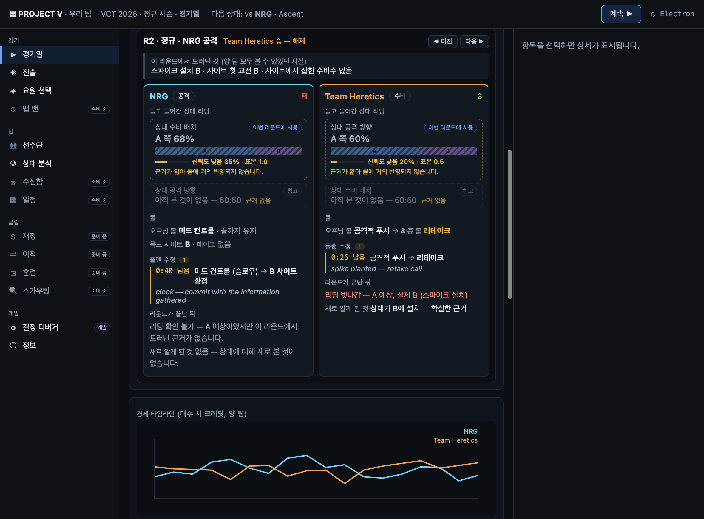
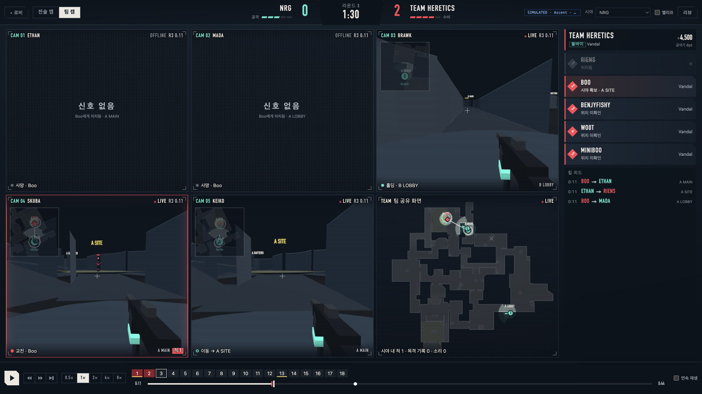

# @pv/desktop

PROJECT V desktop app — a **manager-game-style** front end (Electron + Vite +
React + TS, DECISION-007) over the PROJECT V simulation and data packages. It
adopts sports-manager **information conventions only**; no third-party game's
branding, screen designs, icons or colour schemes are copied.


Shell: left nav (MATCH / TEAM / CLUB / DEV), a top context bar (team · season ·
next match · Continue), main content, and a right detail panel. DECISION-001 —
the match/data screens work first; club ops are reserved "준비 중" placeholders.

## Screens & data sources

| Screen | Status | Data |
|---|---|---|
| **Match Day** | working (REAL sim) | PV-4 `@pv/round-simulator` in a separate process (real 5v5 rounds), real team select, coach note from a real PV-3 trace; fog-of-war + Belief heatmap are **TODO** (need PV-3 Belief State) |
| **Match Day → Review (post-match)** | working (REAL sim) | match-runner summary + replay: round results, **round decisions** (each team's read, call, plan changes — see below), economy timeline, timeout log, MVP, ground-truth replay |
| **Match Day** | working (REAL sim) | `@pv/match-runner` in a separate process (one-shot map or interactive round-by-round session with tactical timeouts and coach orders). While a match is on, the screen is the full-window **live match view** — tactical map / team cams, see below |
| **Squad / Player Profile** | working | PV-2 `player_ratings` + `player_names` — 402 real VCT players, 1–20 grid, uncertainty, explicit null |
| **Opponent Report** | working | PV-2 `team_profiles` + `team_names` — 70 real teams, economy + map pool |
| **Tactics** | working (list) | PV-1 `ascent-tactics` (provenance tags shown) |
| **Agent Select** | working (data) | PV-1 `ascent-comps` (win rates + CI, role templates) |
| **Dev → Decision Debugger** | working | real PV-3 `@pv/decision-debugger` traces (Handoff §21) |
| **About** | working | pre-release real-names disclaimer |
| **Series · Map veto** | working (REAL engine) | `@pv/match-runner` series layer (`createSeriesSession`): Bo1/Bo3/Bo5, step-by-step veto vs the AI, per-map mastery + scouting, maps played through Match Day — see below |
| Inbox / Schedule / Finance / Transfers / Training / Scouting | 준비 중 | — |

Data fixtures are copied from PV-1/PV-2 branches; see `src/data/README.md` and
`test/fixtures/traces/README.md` for exact sources. All values are
**synthetic/estimated**. Real VCT **professional** player/team names are shown by
user decision for pre-release internal development only — license / name /
likeness rights must be re-reviewed before any launch. The `.vrf` sample players
(non-pro) stay anonymous (`player_N`).

## Round decisions (post-match Review)



The Review tab's **라운드별 판단 / Round decisions** card shows *why* each round went
the way it did, from the engine's `RoundRecord.decisions` (`@pv/match-runner`;
background in `docs/CONTINUOUS_TACTICAL_INTELLIGENCE.md` at the repo root). Pick a
round; for **both teams** it reads as an analyst's note:

- **들고 들어간 상대 리딩 / Read of the opponent going in** — where the team thinks
  the opponent attacks and defends (`opponentReadBefore`). The estimate that matters
  for the side it plays this round is tagged *used this round* (attacking → where
  they defend; defending → where they attack); the other is a compact reference
  line. Each shows the lean ("A 쪽 68%"), an A|B split bar, and confidence with the
  sample count. **Thin evidence is visibly weak**: no data → grey hatched bar,
  "근거 없음", no percentage; low confidence (< 0.4, i.e. about one round of
  evidence) → hatched bar, dashed amber frame and a note that it barely moves the
  call; medium < 0.6 ≤ high. With opponent memory off the read is `null` and the
  card says so.
- **콜 / The call** — opening call → final call, the objective site, and the fake
  ("A를 먼저 보여준 뒤 전환") if any. When the team held a read at medium+ confidence,
  one line says whether the opening went **with** it (defence stacks the expected
  site; attack goes away from the expected stack), **against** it, or picked no site.
- **플랜 수정 / Plan changes** — every revision with the round clock remaining
  ("1:23 남음"), from → to, and the engine's reason. No revisions → "수정 없음".
- **라운드가 끝난 뒤 / After the round** — whether the read held up against what the
  round showed (plant > first contact for the defence; where defenders fell for the
  attack), and what the team learned (the evidence its model takes into the next round).

Above the picker, **경기 전체: 상대에 맞춰 적응했는가 / Did they adapt?** totals per
team: rounds with a mid-round plan change, fakes, openings with / against the read,
and how often the read was right. The picker marks rounds with a plan change (●) or
a fake (F). So "why did they rotate?" is the plan-change line of that round, and
"did they adapt to us?" is the read + with/against line across rounds and the summary.

Data path: `scripts/run-match.mts` / `scripts/match-session.mts` pass `decisions`
through untouched → `mergeMatch` (`src/shared/match-merge.ts`) →
`MatchRoundSummary.decisions` (`src/shared/ipc.ts`) → view model
`src/renderer/decisions.ts` (pure; unit-tested in `test/decisions.test.ts`) →
`src/renderer/screens/DecisionsPanel.tsx`. The two judgements the view adds on top
of the engine data (with/against the read, read right/wrong) are computed and
documented in `decisions.ts`; everything else is shown as recorded. Matches from an
engine without `decisions` (or the browser stub) show "판단 기록이 없습니다".

**Not localised yet:** revision `reason` strings ("spike planted — retake call",
"enemies reading B — rotate/stack B", …) are free English text built inside
`@pv/team-engine` and are shown verbatim in both languages. Localising them needs
the engine to emit a reason *key* (+ params) per revision; the UI would then map it
through `ko.ts` / `en.ts`. Revision `from` / `to` are parsed on the desktop side
(`parseCall`: strategy ids, the `" (slow)"` suffix, `"commit A|B"`) and are localised.

## Series · map veto


**시리즈 · 밴픽 / Series · Veto** (left nav) runs a best-of-1/3/5 on the engine's series layer
(`docs/SERIES_AND_VETO.md` at the repo root has the formulas and the measured effects).

> **Every map is currently simulated on the Ascent geometry.** The engine only has spatial data
> for Ascent, so a "Lotus" game is an Ascent game with Lotus's mastery and scouting applied. The
> veto and series screens carry a persistent note saying so, and Match Day shows it on such maps.

Flow:

1. **Setup** — our team, the opponent, the format, the seed, and the team's own pre-match options:
   **상대 사전 분석 / Scout the opponent** and **분석관 수준 / Analyst quality** (0–1; how many of their
   games are reviewed and how exact the estimate of their map mastery is).
2. **Veto** — the pool as cards. The bar at the top always says whose turn it is and what the step
   is (ban / pick / choose side, `n/total`). We make our team's choices (the card's 밴/픽 button, or
   the side buttons); the AI makes the opponent's one step at a time, ~1 s apart, each landing in
   the veto log tagged `AI`. Banned maps grey out and are struck through; picked maps show
   "N맵 · team 픽" and our starting side; the last map left is marked **디사이더 / Decider**.
3. **Decision support, on the same screen** — every card shows our mastery and our analysts'
   estimate of theirs (0–100, `±` one standard deviation). Selecting a card opens the breakdown
   for both teams — map record, roster continuity, composition fit, each with its own `±` and the
   note of what it is based on ("34경기 24승", "선수별 맵 출전 기록 기준") — and the scouting report for that
   map: strong / average / weak verdict, where they attack and defend with the amount of evidence
   behind it, and how many games were reviewed. **Uncertain numbers look uncertain**: at
   `±` ≥ 10 the bar is hatched amber with a dashed outline and the `±` is highlighted (the same
   idea as low-confidence reads in the Review); "not scouted" is a grey hatched bar with no number.
   The **분석팀 추천 / Staff advice** line gives the engine's recommended choice (it searches the
   rest of the veto on our own win estimates) with the visible numbers behind it, and a one-click
   "추천대로".
4. **Maps** — between maps the series scoreboard lists every map (who picked it, our starting
   side, score). The next map opens in the existing **Match Day** (one-shot or round by round with
   timeouts) with a banner and a "시리즈로 돌아가기" button, or is simulated in one go
   ("결과만 빠르게"). Leaving an unfinished map plays it out.
5. **Summary** — winner, map scores, the full veto record, mastery by map.


Data path: `scripts/series-session.mts` (one long-lived tsx subprocess hosting
`createSeriesSession`; line-delimited JSON like `match-session.mts`) ⇄ `src/main/series-host.ts`
⇄ IPC `pv:series:{start,cmd,stop}` ⇄ `src/renderer/series/useSeries.ts` → view logic
`src/renderer/series/view.ts` (pure; `test/series-view.test.ts`) → `screens/series/*`. The host
reports every game from **our seat** (our team is always slot A, whichever side it starts on), so
Match Day needs no change in how it reads a match: a map of the series is requested with
`seriesGame: true` on the ordinary `runSimulation` / `sessionStart` calls and the session channels
are routed to the series host while that map is open.

What is simulated rather than real: the **scouting film** is each team's last two games against
other teams, simulated at series start (`PV_SERIES_FILM` changes the count) — the data has no real
per-round history. The map records themselves are real (`packages/game-data/data/map-history.json`:
maps played and won per team and per player since 2025); a team without a record shows
"승패 데이터 없음" and is treated as neutral. Not built yet: the team game plan (site leans)
and both-teams-human veto have no UI; a series does not survive leaving the screen's route
mid-series (the host keeps running, the screen state is not restored).

## Pre-match options (match setup)

**⚙ 경기 옵션 / Match options** on Match Day exposes the `MatchConfig` options that
are a team's or organiser's choice; they apply to both one-shot and interactive
matches and lock while a session is live:

- **상대 기억 / Opponent memory** (`opponentMemory`, default on) — off makes both
  teams play every round like the first; the Review then shows no reads.
- **최소 쓰로잉률 / Minimum throw rate** per team (`minThrowRates.teams[teamId]`,
  /s, default 0) — a floor on how often a player breaks a winning post-plant hold.

Only non-default choices are sent, so a default match is exactly the engine's
default config. Per-player floors (`minThrowRates.players`) pass through the IPC
types and scripts but have no UI yet. The physics tunables in `MatchConfig.tuning`
are deliberately not exposed.
## Live match view (Match Day while a match is played or watched)

Starting a match (one-shot or interactive) opens a full-window broadcast-style screen
(`src/renderer/screens/matchday/`, logic in `src/renderer/matchday/`). **◂ 로비** returns to the
shell without stopping the session; the shell's Match Day then shows the score so far and a
button back into the match. Look and layout follow tactical-shooter spectator-HUD conventions
(top-centre score and round clock, rosters left/right, kill feed, spike timer, angular panels,
ally teal / enemy red); no Riot logo, font, icon or screen is copied. Team colours are always
doubled by shape (ally circle, enemy diamond, sound ring, spike hexagon).

Two view modes, switched with the toggle top-left (or `M`); the choice, the playback tempo and
the belief overlay persist in `localStorage` (`pv-matchday-view`):

| | Tactical map (`전술 맵`) | Team cams (`팀 캠`) |
|---|---|---|
|  | The 2D map is the centre and largest element; our roster + team intel left, opponent roster + kill feed right, score/clock top, transport + coach actions bottom. Nothing scrolls at 1280×720 or 1920×1080. | |
|  | | Five **first-person 3D cameras**, one per player of our team, plus the team's shared 2D picture. Camera at the player's position and eye height, looking along their facing; CAM id, name, LIVE/OFFLINE, round time, what they are doing, a radar inset. Death → "신호 없음" (signal lost). Click a monitor to focus it. |

Shared by both modes — **a round is watched in full**: it plays from the round start to the round
end in real time (1× by default; 0.5×/2×/4×/8× on request) and then stops. Nothing advances on its
own: the next round starts from the round summary (result, reason, kills, credits, buys and — when
the bridge passes `RoundRecord.decisions` through — our own plan changes) or the `다음 라운드`
button; `자동 진행` / `연속 재생` is an explicit opt-in. Controls are always on screen: play/pause,
speed, a scrubber over the round, previous/next event, and skip-to-round-end as a deliberate
choice. `Space` = play/pause, `←/→` = previous/next event (a jump lands 1.5 s before the event).

Nothing reveals a round before it happens: score, clock, alive pips, rosters, kill feed and the
round chip all follow the playhead, and the scrubber only marks events (kills, plant, defuse,
timeouts) up to the furthest point you have watched — a round you have already seen keeps its
marks. Banners appear when they matter (spike planted + countdown, 1 v N clutch, opponent
timeout), and the tactical timeout opens the orders sheet over the stage.

### No invented routes
The live view never draws a straight line between zone centres as if it were a route: no movement
trails, plan arrows or rotation lines, and the navgraph's travel edges are hidden (the
`구역 그래프 (디버그)` checkbox on the tactical map shows them, labelled as not being routes). A
player on the way somewhere is shown by a ring on the destination zone. The only lines on the map
connect two real positions in a fight (a player and the enemy they see). The 3D blockout — used
only when no map mesh is installed — is still a schematic of the zone graph, so its corridors are
straight; the older `ReplayViewer` (Review's full-view replay and Dev) still interpolates between
keyframes through `@pv/replay-engine`.

### The coach sees only what the team knows
The default view is OUR team's fog of war: our players, enemies while one of our players sees
them, remembered sightings (hollow, fading with age), sound cues, and — public information —
kills and the planted spike. The opponent's real positions are never drawn otherwise. The
`시야` select can switch the tactical map to the opponent's fog for debugging (labelled
"디버그"; the app had that POV switch before); the cams are always our team. Ground truth stays
in Dev.

### Data each mode uses
| Source | Used for |
|---|---|
| `Replay.tracks` (per-round `move` events) | our players' positions; enemies only once gated by perception |
| `Replay.events` kill / plant / defuse / roundEnd | kill feed, spike state and clock, round result, monitor states |
| `Replay.perception[team]` snapshots (500 ms) | observed enemies, sound cues, belief zones |
| `MatchSummary.rounds[]` | attacker (engine id → team), buys/weapon, economy, score |
| `src/data/sim/ascent.navgraph.json` | zones, travel edges, sightlines, sound links (vision/hearing rules, blockout) |
| `@pv/game-data` `rosters.json` (read-only import) | engine slot 1..5 → real player handle |

**Position tracks come from the engine.** The match scripts ask for them with `MatchConfig.recordTracks`
(`scripts/run-match.mts`, `match-session.mts`, `series-session.mts`): every player's position on every tick,
written into each round's replay as `move` events, starting with one zero-length move per player so that a
player who never leaves their spot still has a position. Players are drawn exactly where the engine recorded
them — consecutive samples joined linearly — and the engine only ever moves a body along its navigation
roadmap, so nobody is drawn crossing a wall (`packages/match-runner/test/movement-floor.test.ts` checks every
recorded position of whole matches against the roadmap). The former app-side `track-shim.mts` is gone.

**Navigation (developer) view.** The checkbox at the bottom right of the tactical map turns on the navigation
debug overlay (off by default, not persisted): the walkable floor as the engine's roadmap knows it
(`src/data/sim/ascent.nav.json`), one-way drops, the zone graph with every zone ringed green (connected) or red
(not), and for each player of the viewed team the destination, the planned waypoints still ahead (coloured by
route preference), the walked trace, replans and refused paths. The panel beside the map says, per player, WHY
that route: what the order is for → goal · route preference · zones avoided (from the team's belief) · length ·
time. It draws engine output only (`RoundRecord.navTrace`); the model is `src/renderer/matchday/navdebug.ts`.
Screen: `docs/desktop-nav-debug.png`.

### Approximations (derived in the renderer — and the engine field that would make each exact)
| Shown | How it is derived today | Exact with |
|---|---|---|
| Movement | **Players are drawn only where the engine recorded them.** Consecutive track samples (≤ 300 ms or ≤ 120 uu apart) are joined linearly, with no re-timing, and players are oriented along their motion. Nothing is ever interpolated between zone centres: with the zone-hop engine at 8e165f4 (one keyframe per zone arrival) a player stays on the origin zone until the engine moves them, the destination zone is ringed and an arc around the player shows how far along the hop they are — no path is drawn, because the straight line between two zone centres is not a route. A small per-player offset separates players that engine stacks on one point | continuous per-tick positions along walkable paths in the replay tracks (then players simply move) |
| Facing | engine rule re-implemented: toward the next zone while travelling, toward the choke on the enemy-spawn → here path when standing; toward the opponent during a duel | `TrackFrame.players[].facing` (a policy `aimZone` overrides the default and is not exported) |
| Which of OUR players sees an enemy | team snapshot `currentlyVisible` ∩ the engine's `canSee` (alive, ≤ 4500 uu, 110° cone, zone sightline) evaluated per player, ∪ the opponent of a kill event the player is in. The team snapshot is the upper bound | per-player `visibleEnemyIds` in the perception snapshot |
| Duels | a kill resolves in one engine tick; the two players are shown squaring up 1.2 s before it | `engage` events (dropped by the replay bridge) with real duel timing |
| What a player hears | team sound cues filtered by loudness × sound-link attenuation to the player's zone; our own footsteps removed by zone | per-player `heardSounds`, and a source team on each cue |
| "Last seen N s ago" | recomputed from when an observed-enemy entry appears/changes (`lastSeenMsAgo` is always 0 in engine output) | a correct `lastSeenMsAgo` |
| Planting / defusing | `[done − 4 s / 7 s, done)` from the plant/defuse events | `plantStart`, `defuseStart`, `defuseInterrupted` (dropped by the bridge) |
| Health / armor / per-player weapon, ult, abilities | **not shown** — the roster shows alive/dead, the team's bought weapon, team credits and ult points | `health`, `armor`, `weaponId`, `ultimatePoints`, ability charges per player per frame |
| Spike carrier before the plant | not shown | `spikePickup` events / carrier id |

### 3D cams: map mesh and blockout
`CamStage3D` (three.js) renders all monitors with ONE WebGL renderer and scissored viewports,
capped at 30 fps; the 2D map (PixiJS) keeps its own canvas and pace.

- **Figures and view model are original.** Players are a procedurally built stylised operator
  (dark fatigues, team-coloured plates and visor, generic rifle, walk cycle); each monitor also
  draws a first-person view model (generic gloved hands + rifle or pistol silhouette, bob while
  moving, recoil and muzzle flash around the kills that player is part of). No character, weapon or
  skin model from the game or any third party is used; identity comes from team colour and the
  player's handle. An enemy the engine counts as seen keeps a marker and name tag that are drawn
  through walls.
- **Blockout (always available; used when no mesh is installed).** Generated at runtime from the navgraph: a round room
  per zone, a walled corridor per travel edge, zone heights, plant areas, callout labels. No wall
  ever stands in a travel lane or across an authored sightline (unit-tested), so it never
  contradicts the simulation. Everything above works on it.
- **Real map mesh (optional, never in git).** If `apps/desktop/assets/maps/ascent.glb` exists
  (gitignored; `PV_MAP_ASSETS_DIR` overrides the folder) the cams load it instead. Build it from
  the user-provided `.blend` with headless Blender 4.2:
  ```bash
  Blender --background --factory-startup --python tools/map-mesh/blender/export-web-glb.py -- \
    --blend <assets>/maps/raw/Ascent.blend --map ascent \
    --navgraph apps/desktop/src/data/sim/ascent.navgraph.json \
    --out <assets>/maps/glb/ascent.glb --report <assets>/maps/glb/ascent.report.json \
    --link apps/desktop/assets/maps/ascent.glb --target-tris 380000
  ```
  The script drops vista/foliage/clutter, bakes material colours into vertex colours (no
  textures leave the .blend), joins per collection, decimates, **calibrates the Blender→game frame
  against the navgraph** and bakes it so sim coordinates map straight onto the mesh. Ascent:
  3.32 M → 380 k triangles, 17.6 MB, 10 draw calls; calibration = 100 uu per Blender metre with y
  flipped (22/22 zone centres over geometry, 17–18/22 on a floor within 0.6 m; the next-best axis
  assignment scores 8).
- **Known limits on the real mesh.** The engine simulates on the 22-zone graph, not on the mesh:
  at 8e165f4 players hop from zone centre to zone centre, so a monitor's camera cuts from one zone
  to the next instead of walking there (the view never invents the path in between). An engine
  that records continuous positions along walkable paths turns that into real movement without any
  change here. An enemy
  the engine counts as seen can still be behind real geometry — its marker is drawn through walls
  rather than hidden; per-player observations would fix that.
- **Measured** (this Mac, 1920×1080, 1× playback, before the view model was added): wall render 0.8–1.4 ms CPU
  per 30 fps tick on the blockout (8 k triangles, 72 draw calls) and ≈1.1 ms with the 600 k-triangle
  mesh (2.0 M triangles per wall render; the 380 k export above is lighter still); the page stayed at 16.6 ms/frame (p95 17.4 ms) in both.
  CPU-side timings only — GPU time is not measured. Under software GL (the e2e flags) the tactical
  map runs at ≈12 fps; the real mesh is not usable there.

## Security posture
- `contextIsolation: true`, `nodeIntegration: false`; the renderer reaches
  privileged work only through the preload whitelist (`src/preload` → `window.pv`:
  `runSimulation`, `loadTrace`, `listTraces`) via `contextBridge`.
- CSP set in `index.html` (PixiJS needs `unsafe-eval` + blob workers, allowed only
  in this local renderer). `sandbox` is off for ESM-preload compat on Electron 33.

## Run / build / verify

```bash
# once, at the repo root: the match runs from workspace source via tsx
pnpm install --frozen-lockfile
cd apps/desktop
npm install
npm run dev                                   # electron-vite dev
npm run typecheck                             # tsc --noEmit
npm run build                                 # → out/{main,preload,renderer}
npm run test:unit                             # IPC contract, trace parser, i18n, match merge, round decisions, series view (40)
npm run test:engine                           # desktop ↔ live engine contract: run-match.mts output shape + options (3)
npm run build && xvfb-run -a npm run test:e2e # Playwright _electron E2E + screenshots (Linux, headless)
npm run build && npm run test:e2e             # macOS / Windows: opens a real window
npm run build && npm run test:e2e:series      # full Bo3 through the veto + Match Day, in Korean and English
npm run test:unit                             # IPC contract + trace parser (6)
npm run test:matchday                         # live match view logic: graph, timeline, visibility, monitors, playback, blockout (29)
npm run build && xvfb-run -a npm run test:e2e # Playwright _electron E2E + screenshots
```

Notes:
- The shared `ReplayViewer` source lives in `../replay-viewer`; `react` / `pixi.js`
  are resolved from *this* app's `node_modules` (`resolve.dedupe` in
  `electron.vite.config.ts`, `paths` in `tsconfig.json`), so no install is needed there.
- `test:engine` needs the repo-root install (`node_modules/.bin/tsx`) and skips with
  a message without it. Run it after any engine change that touches `RoundRecord`.
- `test:e2e` needs Playwright, which is not a dependency of this app: set
  `PLAYWRIGHT_REQUIRE_BASE` to a directory whose `node_modules` has `playwright`
  (e.g. `PLAYWRIGHT_SKIP_BROWSER_DOWNLOAD=1 npm i playwright` in a temp dir; no
  browser download is needed for `_electron`). It pins the UI language to Korean,
  plays one-shot and interactive matches, checks the round-decisions view in both
  languages and the opponent-memory option, and rewrites the PNGs in `docs/`.
- `test:e2e:series` (same Playwright setup) plays a whole best-of-three twice — Korean, then
  English: a first ban against the staff advice, the AI's replies, map 1 through Match Day in one
  go, map 2 round by round, a decider if needed, the summary — checks for sideways overflow at
  1280×720 and 1920×1080, and writes `docs/desktop-veto*.png` / `desktop-series-summary*.png`.
- `test/review.test.ts` is not in `test:unit`: `src/renderer/data.ts` imports JSON
  without an import attribute, which Node's test runner rejects (Vite is fine).

Windows is the first target (README §07); development and verification here were
on Linux (Electron under `xvfb` + SwiftShader). If Electron can't be installed,
the renderer still runs in plain-browser mode (`window.pv` absent → in-page
`StubRunner` + bundled fixtures; see `src/renderer/platform.ts`).

## Integration swap points (TODO)
1. **`SimulationRunner`** (`src/shared/sim.ts`) — `StubRunner` → PV-4/PV-3 real
   Match Runner (`pnpm sim:match` on the integration branch), same interface; the
   worker + IPC path stay unchanged.
2. **Per-player data for the live match view** — see "Approximations" above for the engine
   fields that would replace each renderer-side derivation.
3. **Spatial adapter** — `src/shared/ascent-transform.ts` (copied PV-4 transform)
   → a real spatial-engine adapter supplying the transform per map.
4. **Team select** — pick two real teams + seed to start a match.

Screens: `docs/desktop-{shell,matchday,squad,debugger,review,review-decisions,review-decisions-en,match-options,veto,veto-1080p,veto-en,series-summary,series-summary-en}.png`.
