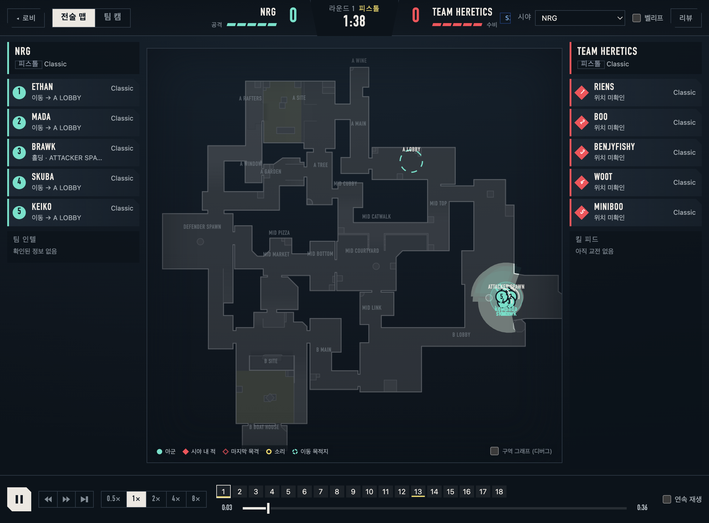

# @pv/desktop

PROJECT V desktop app — a **manager-game-style** front end (Electron + Vite +
React + TS, DECISION-007) over the PROJECT V simulation and data packages. It
adopts sports-manager **information conventions only**; no third-party game's
branding, screen designs, icons or colour schemes are copied.



Shell: left nav (MATCH / TEAM / CLUB / DEV), a top context bar (team · season ·
next match · Continue), main content, and a right detail panel. DECISION-001 —
the match/data screens work first; club ops are reserved "준비 중" placeholders.

## Screens & data sources

| Screen | Status | Data |
|---|---|---|
| **Match Day** | working (REAL sim) | `@pv/match-runner` in a separate process (one-shot map or interactive round-by-round session with tactical timeouts and coach orders). While a match is on, the screen is the full-window **live match view** — tactical map / team cams, see below |
| **Squad / Player Profile** | working | PV-2 `player_ratings` + `player_names` — 402 real VCT players, 1–20 grid, uncertainty, explicit null |
| **Opponent Report** | working | PV-2 `team_profiles` + `team_names` — 70 real teams, economy + map pool |
| **Tactics** | working (list) | PV-1 `ascent-tactics` (provenance tags shown) |
| **Agent Select** | working (data) | PV-1 `ascent-comps` (win rates + CI, role templates) |
| **Dev → Decision Debugger** | working | real PV-3 `@pv/decision-debugger` traces (Handoff §21) |
| **About** | working | pre-release real-names disclaimer |
| Map Veto / Inbox / Schedule / Finance / Transfers / Training / Scouting | 준비 중 | — |

Data fixtures are copied from PV-1/PV-2 branches; see `src/data/README.md` and
`test/fixtures/traces/README.md` for exact sources. All values are
**synthetic/estimated**. Real VCT **professional** player/team names are shown by
user decision for pre-release internal development only — license / name /
likeness rights must be re-reviewed before any launch. The `.vrf` sample players
(non-pro) stay anonymous (`player_N`).

## Live match view (Match Day while a match is played or watched)

Starting a match (one-shot or interactive) opens a full-window broadcast-style screen
(`src/renderer/screens/matchday/`, logic in `src/renderer/matchday/`). **◂ 로비** returns to the
shell without stopping the session; the shell's Match Day then shows the score so far and a
button back into the match. Look and layout follow tactical-shooter spectator-HUD conventions
(top-centre score and round clock, rosters left/right, kill feed, spike timer, angular panels,
ally teal / enemy red); no Riot logo, font, icon or screen is copied. Team colours are always
doubled by shape (ally circle, enemy diamond, sound ring, spike hexagon).

Two view modes, switched with the toggle top-left (or `M`); the choice, the playback tempo and
the belief overlay persist in `localStorage` (`pv-matchday-view`):

| | Tactical map (`전술 맵`) | Team cams (`팀 캠`) |
|---|---|---|
|  | The 2D map is the centre and largest element; our roster + team intel left, opponent roster + kill feed right, score/clock top, transport + coach actions bottom. Nothing scrolls at 1280×720 or 1920×1080. | |
|  | | Five **first-person 3D cameras**, one per player of our team, plus the team's shared 2D picture. Camera at the player's position and eye height, looking along their facing; CAM id, name, LIVE/OFFLINE, round time, what they are doing, a radar inset. Death → "신호 없음" (signal lost). Click a monitor to focus it. |

Shared by both modes — **a round is watched in full**: it plays from the round start to the round
end in real time (1× by default; 0.5×/2×/4×/8× on request) and then stops. Nothing advances on its
own: the next round starts from the round summary (result, reason, kills, credits, buys and — when
the bridge passes `RoundRecord.decisions` through — our own plan changes) or the `다음 라운드`
button; `자동 진행` / `연속 재생` is an explicit opt-in. Controls are always on screen: play/pause,
speed, a scrubber over the round, previous/next event, and skip-to-round-end as a deliberate
choice. `Space` = play/pause, `←/→` = previous/next event (a jump lands 1.5 s before the event).

Nothing reveals a round before it happens: score, clock, alive pips, rosters, kill feed and the
round chip all follow the playhead, and the scrubber only marks events (kills, plant, defuse,
timeouts) up to the furthest point you have watched — a round you have already seen keeps its
marks. Banners appear when they matter (spike planted + countdown, 1 v N clutch, opponent
timeout), and the tactical timeout opens the orders sheet over the stage.

### No invented routes
The live view never draws a straight line between zone centres as if it were a route: no movement
trails, plan arrows or rotation lines, and the navgraph's travel edges are hidden (the
`구역 그래프 (디버그)` checkbox on the tactical map shows them, labelled as not being routes). A
player on the way somewhere is shown by a ring on the destination zone. The only lines on the map
connect two real positions in a fight (a player and the enemy they see). The 3D blockout — used
only when no map mesh is installed — is still a schematic of the zone graph, so its corridors are
straight; the older `ReplayViewer` (Review's full-view replay and Dev) still interpolates between
keyframes through `@pv/replay-engine`.

### The coach sees only what the team knows
The default view is OUR team's fog of war: our players, enemies while one of our players sees
them, remembered sightings (hollow, fading with age), sound cues, and — public information —
kills and the planted spike. The opponent's real positions are never drawn otherwise. The
`시야` select can switch the tactical map to the opponent's fog for debugging (labelled
"디버그"; the app had that POV switch before); the cams are always our team. Ground truth stays
in Dev.

### Data each mode uses
| Source | Used for |
|---|---|
| `Replay.tracks` (per-round `move` events) | our players' positions; enemies only once gated by perception |
| `Replay.events` kill / plant / defuse / roundEnd | kill feed, spike state and clock, round result, monitor states |
| `Replay.perception[team]` snapshots (500 ms) | observed enemies, sound cues, belief zones |
| `MatchSummary.rounds[]` | attacker (engine id → team), buys/weapon, economy, score |
| `src/data/sim/ascent.navgraph.json` | zones, travel edges, sightlines, sound links (vision/hearing rules, blockout) |
| `@pv/game-data` `rosters.json` (read-only import) | engine slot 1..5 → real player handle |

**Position tracks come from an app-side bridge.** `@pv/match-runner` does not forward
`recordTracks`, so the app received no player positions at all. `scripts/track-shim.mts` turns the
simulator's own track recording on from the app's two match scripts (outcomes, sim events and
perception are identical with and without it) and adds a spawn position per player. It reads a
private simulator field; if that breaks, the screen says positions are unavailable. The clean fix
is a `MatchConfig.recordTracks` option in the engine.

### Approximations (derived in the renderer — and the engine field that would make each exact)
| Shown | How it is derived today | Exact with |
|---|---|---|
| Movement | **Players are drawn only where the engine recorded them.** Consecutive track samples (≤ 300 ms or ≤ 120 uu apart) are joined linearly, with no re-timing, and players are oriented along their motion. Nothing is ever interpolated between zone centres: with the zone-hop engine at 8e165f4 (one keyframe per zone arrival) a player stays on the origin zone until the engine moves them, the destination zone is ringed and an arc around the player shows how far along the hop they are — no path is drawn, because the straight line between two zone centres is not a route. A small per-player offset separates players that engine stacks on one point | continuous per-tick positions along walkable paths in the replay tracks (then players simply move) |
| Facing | engine rule re-implemented: toward the next zone while travelling, toward the choke on the enemy-spawn → here path when standing; toward the opponent during a duel | `TrackFrame.players[].facing` (a policy `aimZone` overrides the default and is not exported) |
| Which of OUR players sees an enemy | team snapshot `currentlyVisible` ∩ the engine's `canSee` (alive, ≤ 4500 uu, 110° cone, zone sightline) evaluated per player, ∪ the opponent of a kill event the player is in. The team snapshot is the upper bound | per-player `visibleEnemyIds` in the perception snapshot |
| Duels | a kill resolves in one engine tick; the two players are shown squaring up 1.2 s before it | `engage` events (dropped by the replay bridge) with real duel timing |
| What a player hears | team sound cues filtered by loudness × sound-link attenuation to the player's zone; our own footsteps removed by zone | per-player `heardSounds`, and a source team on each cue |
| "Last seen N s ago" | recomputed from when an observed-enemy entry appears/changes (`lastSeenMsAgo` is always 0 in engine output) | a correct `lastSeenMsAgo` |
| Planting / defusing | `[done − 4 s / 7 s, done)` from the plant/defuse events | `plantStart`, `defuseStart`, `defuseInterrupted` (dropped by the bridge) |
| Health / armor / per-player weapon, ult, abilities | **not shown** — the roster shows alive/dead, the team's bought weapon, team credits and ult points | `health`, `armor`, `weaponId`, `ultimatePoints`, ability charges per player per frame |
| Spike carrier before the plant | not shown | `spikePickup` events / carrier id |

### 3D cams: map mesh and blockout
`CamStage3D` (three.js) renders all monitors with ONE WebGL renderer and scissored viewports,
capped at 30 fps; the 2D map (PixiJS) keeps its own canvas and pace.

- **Figures and view model are original.** Players are a procedurally built stylised operator
  (dark fatigues, team-coloured plates and visor, generic rifle, walk cycle); each monitor also
  draws a first-person view model (generic gloved hands + rifle or pistol silhouette, bob while
  moving, recoil and muzzle flash around the kills that player is part of). No character, weapon or
  skin model from the game or any third party is used; identity comes from team colour and the
  player's handle. An enemy the engine counts as seen keeps a marker and name tag that are drawn
  through walls.
- **Blockout (always available; used when no mesh is installed).** Generated at runtime from the navgraph: a round room
  per zone, a walled corridor per travel edge, zone heights, plant areas, callout labels. No wall
  ever stands in a travel lane or across an authored sightline (unit-tested), so it never
  contradicts the simulation. Everything above works on it.
- **Real map mesh (optional, never in git).** If `apps/desktop/assets/maps/ascent.glb` exists
  (gitignored; `PV_MAP_ASSETS_DIR` overrides the folder) the cams load it instead. Build it from
  the user-provided `.blend` with headless Blender 4.2:
  ```bash
  Blender --background --factory-startup --python tools/map-mesh/blender/export-web-glb.py -- \
    --blend <assets>/maps/raw/Ascent.blend --map ascent \
    --navgraph apps/desktop/src/data/sim/ascent.navgraph.json \
    --out <assets>/maps/glb/ascent.glb --report <assets>/maps/glb/ascent.report.json \
    --link apps/desktop/assets/maps/ascent.glb --target-tris 380000
  ```
  The script drops vista/foliage/clutter, bakes material colours into vertex colours (no
  textures leave the .blend), joins per collection, decimates, **calibrates the Blender→game frame
  against the navgraph** and bakes it so sim coordinates map straight onto the mesh. Ascent:
  3.32 M → 380 k triangles, 17.6 MB, 10 draw calls; calibration = 100 uu per Blender metre with y
  flipped (22/22 zone centres over geometry, 17–18/22 on a floor within 0.6 m; the next-best axis
  assignment scores 8).
- **Known limits on the real mesh.** The engine simulates on the 22-zone graph, not on the mesh:
  at 8e165f4 players hop from zone centre to zone centre, so a monitor's camera cuts from one zone
  to the next instead of walking there (the view never invents the path in between). An engine
  that records continuous positions along walkable paths turns that into real movement without any
  change here. An enemy
  the engine counts as seen can still be behind real geometry — its marker is drawn through walls
  rather than hidden; per-player observations would fix that.
- **Measured** (this Mac, 1920×1080, 1× playback, before the view model was added): wall render 0.8–1.4 ms CPU
  per 30 fps tick on the blockout (8 k triangles, 72 draw calls) and ≈1.1 ms with the 600 k-triangle
  mesh (2.0 M triangles per wall render; the 380 k export above is lighter still); the page stayed at 16.6 ms/frame (p95 17.4 ms) in both.
  CPU-side timings only — GPU time is not measured. Under software GL (the e2e flags) the tactical
  map runs at ≈12 fps; the real mesh is not usable there.

## Security posture
- `contextIsolation: true`, `nodeIntegration: false`; the renderer reaches
  privileged work only through the preload whitelist (`src/preload` → `window.pv`:
  `runSimulation`, `loadTrace`, `listTraces`) via `contextBridge`.
- CSP set in `index.html` (PixiJS needs `unsafe-eval` + blob workers, allowed only
  in this local renderer). `sandbox` is off for ESM-preload compat on Electron 33.

## Run / build / verify

```bash
cd apps/desktop
npm install
npm run dev                                   # electron-vite dev
npm run build                                 # → out/{main,preload,renderer}
npm run test:unit                             # IPC contract + trace parser (6)
npm run test:matchday                         # live match view logic: graph, timeline, visibility, monitors, playback, blockout (29)
npm run build && xvfb-run -a npm run test:e2e # Playwright _electron E2E + screenshots
```

Windows is the first target (README §07); development and verification here were
on Linux (Electron under `xvfb` + SwiftShader). If Electron can't be installed,
the renderer still runs in plain-browser mode (`window.pv` absent → in-page
`StubRunner` + bundled fixtures; see `src/renderer/platform.ts`).

## Integration swap points (TODO)
1. **`SimulationRunner`** (`src/shared/sim.ts`) — `StubRunner` → PV-4/PV-3 real
   Match Runner (`pnpm sim:match` on the integration branch), same interface; the
   worker + IPC path stay unchanged.
2. **Per-player data for the live match view** — see "Approximations" above for the engine
   fields that would replace each renderer-side derivation, and `scripts/track-shim.mts`.
3. **Spatial adapter** — `src/shared/ascent-transform.ts` (copied PV-4 transform)
   → a real spatial-engine adapter supplying the transform per map.
4. **Team select** — pick two real teams + seed to start a match.

Screens: `docs/desktop-{shell,matchday,squad,debugger}.png`.
