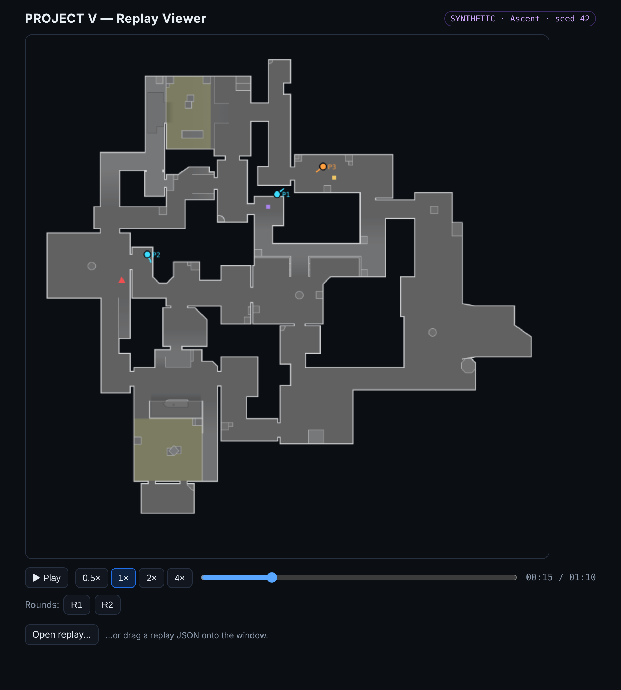

# @pv/replay-viewer

Standalone web viewer for PROJECT V replays (Vite + React + TypeScript + PixiJS,
DECISION-007). It plays **decoded real `.vrf`** trajectories and **simulated**
rounds through the same `@pv/replay-engine` format — the UI never touches engine
internals (Handoff §24.5).



*Synthetic fixture (left) and a decoded real `.vrf` (anonymized) both render on
the live Ascent minimap. Real capture:* `docs/screenshot-real.png`.

## Features
- Player dots + view-direction lines on the real map minimap (fetched at runtime
  from valorant-api; the image is never committed).
- Team coloring, dead/alive state, event markers (kill / plant / ability).
- Timeline scrub, play / pause, **0.5× / 1× / 2× / 4×** speed (speed is independent
  of state — DECISION-010), round jump buttons, source badge.
- **Drag-and-drop** a replay JSON onto the window, or **Open replay…**.
- Ships a committable **synthetic** replay fixture; needs no real data to demo.

## Run it

```bash
cd apps/replay-viewer
npm install
npm run dev          # http://localhost:5178  (loads the synthetic fixture)
```

The app stands alone (its own `package.json`); it resolves `@pv/replay-engine`
to the package source via a Vite alias. Root monorepo wiring is not required.

## One line: a `.vrf` → the viewer

```bash
# 1) decode + normalize the .vrf (see tools/replay-parser)
PARSER=/path/to/ValorantReplayParser REDACT=1 tools/replay-parser/run.sh my.vrf Ascent
#    → tools/replay-parser/output/my/raw.json  (+ normalized.json)

# 2) convert that to an ANONYMIZED replay the viewer can open (gitignored output)
node --experimental-strip-types apps/replay-viewer/scripts/gen-real-replay.ts \
     tools/replay-parser/output/my/raw.json \
     apps/replay-viewer/public/fixtures/real-ascent.local.json

# 3) open it
cd apps/replay-viewer && npm run dev   # then browse to /?replay=/fixtures/real-ascent.local.json
```

`?replay=<url>` loads any replay JSON; `?t=<ms>` seeks on load. A replay
converted from a real `.vrf` uses anonymous `player_N` ids and is **not
committed** (`real-*.json` is gitignored) — regenerate it locally.

## Screenshots / tests

```bash
npm run build
npm run screenshot   # Playwright: builds a PNG of the synthetic fixture (+ real, if generated)
                     # writes to apps/replay-viewer/docs/
```

Engine logic (interpolation, seek, converters) is unit-tested in
`packages/replay-engine` (`npm test` there).

## Privacy
`.vrf` `ProfileName` can be a real Riot ID in customs. The converter strips it;
the viewer only ever shows anonymous `player_N`. Do not commit real `.vrf` files
or replays derived from them.
