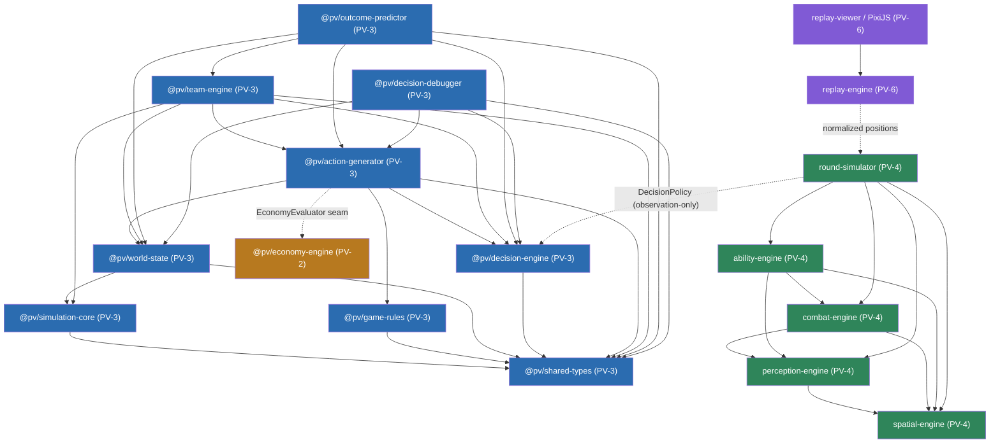
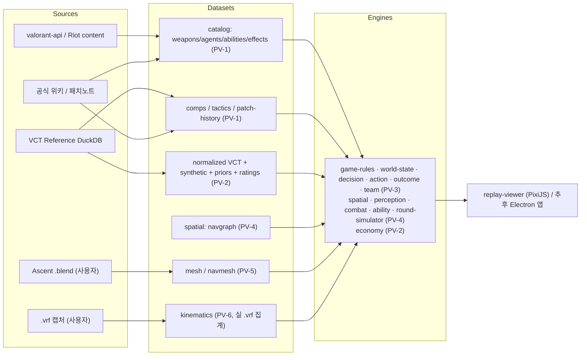
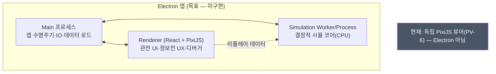

# PROJECT V — Integrated Architecture (제안)

**작성:** PV-1 Research (9차 종합) · **기준일:** 2026-11-18 · PV-3 `docs/ARCHITECTURE.md`(읽기) 기반 통합 제안.

> **상태:** 아래 패키지들은 아직 **서로 다른 브랜치에 분산**되어 있다(미머지). 이 문서는 **통합 후** 목표
> 구조를 제안한다. 의존 관계는 각 브랜치 handoff·package.json에서 확인된 것만 그린다. 파일명을 `.integrated.md`로
> 둔 것은 PV-3 원본 `ARCHITECTURE.md`와의 충돌 회피용(원본 미수정).
> 기준 커밋: core `9d7ba29` · spatial `94fa92f` · data `0eb7010` · replay `06b46d6` · mapmesh `5840e6d` · research `c978c86`.

## 1. 패키지 의존성 그래프 (확인된 것만)

- **단일 진실원:** `@pv/shared-types`(모든 상태/계약 타입). 순환 없음(PV-3).
- **정보 경계(DECISION-004):** `world-state.observeWorld`가 World→Observation 변환. round-simulator는 **관측만** 보는 `DecisionPolicy`로 결정(전지적 금지).
- **점선 seam:** 아직 브랜치 간 계약 수준(AG↔economy-engine, RS↔DecisionPolicy, replay→round-simulator). 머지 후 실선화.

## 2. 데이터 흐름 (데이터셋 → 엔진 → UI)

- 실데이터와 **합성 데이터는 분리**(PV-2 `synthetic/` ↔ `normalized/`). 대용량 원본(.duckdb/.blend/.vrf/navmesh .bin)은 gitignore.
- Layer A(통계)=VCT Reference(실). **Layer B(위치)=현재 합성**; 실측은 사용자 `.vrf`→PV-6 경로.

## 3. 프로세스 경계 (목표, DECISION-006/007)

- **분리 원칙:** 경기 연산(시뮬)과 렌더링 분리(DECISION-006). 시뮬은 GPU 없이 CPU에서(결정적).
- **현재 상태:** Electron 앱 쉘 **미구현**. pv-replay의 PixiJS 뷰어는 독립 실행. 통합 시 Renderer에 편입 제안.
- 빌드: PV-3 모노레포는 **빌드리스**(`exports: ./src/index.ts`, pnpm symlink). 번들/emit은 Electron 앱 단계 과제.

## 4. 통합 시 유의 (PRE_MERGE_AUDIT 연계)
- 패키지 네임스페이스 혼재: PV-3 `@pv/*` ↔ PV-4 `@project-v/*` → 머지 시 통일 권고.
- 루트 설정(package.json/pnpm-workspace/tsconfig) 브랜치별 상이 → reconcile.
- 공간 좌표 단위: 카탈로그 m ↔ 엔진/ spatial world units(×100) 변환 규칙 유지(§CATALOG 3.9).
