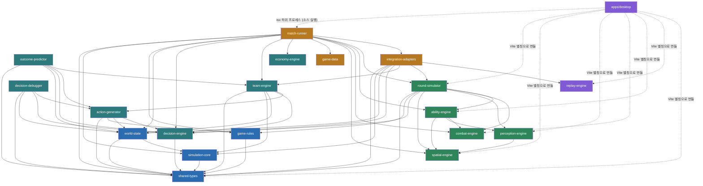
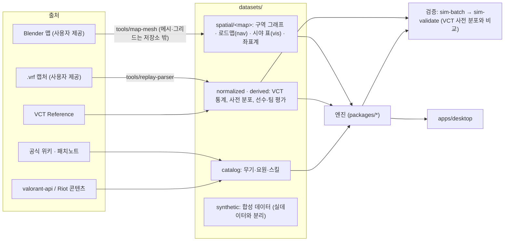
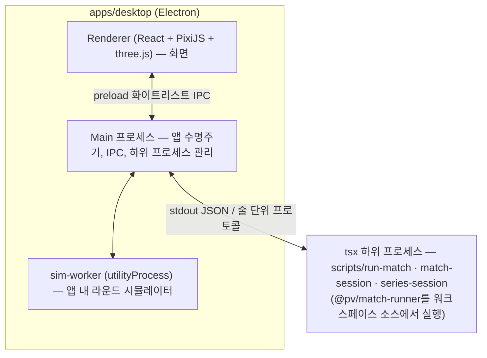

# PROJECT V — 통합 아키텍처 (현재 상태)

**기준일:** 2026-11-20 · **기준:** `claude/nav-engine` 브랜치 머리(= `main` `8cb75cd` + 내비게이션 엔진 작업).

> 이 문서는 2026-11-18의 "통합 **제안**"(패키지가 브랜치별로 흩어져 있던 시점)을 대체한다. 지금은 모든 패키지가
> 한 저장소에 있고 데스크톱 앱까지 연결되어 있으므로, 아래는 제안이 아니라 **있는 그대로의 구조**다.
> 의존 관계는 각 `package.json`에서, 실행 흐름은 코드에서 확인한 것만 적었다.
> 시뮬레이션 코어 네 패키지의 설계 원칙(정보 경계, 결정성)은 `docs/ARCHITECTURE.md`가 원전이다.

## 1. 패키지 지도

| 계층 | 패키지 | 하는 일 |
|---|---|---|
| 계약 | `@pv/shared-types` | 상태·이벤트·행동·출처 타입. 모든 패키지가 공유하는 단일 진실원 |
| 코어 | `@pv/simulation-core` | 시드 RNG(스트림 분리), 고정 틱 시계, 이벤트 로그 |
| | `@pv/game-rules` | 패치별 규칙 데이터(라운드·스파이크·경제·궁극기) |
| | `@pv/world-state` | 월드 생성·불변 갱신·직렬화, World → Observation 경계 |
| 판단 | `@pv/decision-engine` | 믿음 상태(구역 확률 분포), 결정 컨텍스트 조립 |
| | `@pv/action-generator` | 상황별 행동 후보 생성·제약 검증·평가 |
| | `@pv/outcome-predictor` | 상위 후보에 대한 예산 제한 예측 |
| | `@pv/team-engine` | IGL 전략·역할·팀 정책(`TeamDecisionPolicy`), 경로 의도(`route-intent.ts`) |
| | `@pv/decision-debugger` | 판단 추적 기록과 사람이 읽는 보고서 |
| | `@pv/economy-engine` | 구매/세이브/궁극기 경제 판단 |
| 공간·전투 | `@pv/spatial-engine` | 구역 그래프, **내비게이션 로드맵과 경로 탐색(`Navigator`)**, 지점 간 시야, 좌표 변환, 맵 레지스트리 |
| | `@pv/perception-engine` | 시야(FOV·거리·위치 기반 시야·연막), 청각, 기억, 팀 공유 → 관측 |
| | `@pv/combat-engine` | 사격 타임라인으로 푸는 1대1 결투(반응·명중·헤드샷·이동 사격 정지 시간) |
| | `@pv/ability-engine` | 스킬을 효과 객체로 배치(연막·벽·플래시·정찰·몰리·슬로우…) |
| | `@pv/round-simulator` | 고정 틱 5v5 라운드 루프. **이동 실행기(`mover.ts`)** 가 선수 위치를 바꾸는 유일한 코드 |
| 경기 | `@pv/match-runner` | 한 맵(피스톨 → 전·후반 → 13승 → 연장), 라운드 간 경제·궁극기, 시리즈·밴픽·스카우팅 |
| | `@pv/integration-adapters` | 판단 계층의 접점(SpatialQuery 등)을 공간·전투 엔진에 연결 |
| | `@pv/game-data` | 팀·로스터·맵 전적·조합 데이터 접근 |
| 리플레이 | `@pv/replay-engine` | 통합 리플레이 포맷(로드·보간·탐색), `.vrf`·시뮬 로그 변환 |
| 앱 | `apps/desktop` (`@pv/desktop`) | Electron 데스크톱 앱 — 매치 데이, 라이브 뷰, 리뷰, 시리즈·밴픽, 스쿼드, 디버거 |
| | `apps/replay-viewer` | 독립 웹 리플레이 뷰어(PixiJS). 데스크톱 앱이 소스를 공유 |

도구(`tools/`): `data-collector`(ETL), `data-validator`(스키마 검증 + 시뮬 검증 `sim-batch`/`sim-validate`),
`catalog-builder`(게임 데이터 카탈로그), `map-mesh`(Blender 맵 → 측정·경로·로드맵·시야 표),
`map-processor`(콜아웃 → 구역 그래프), `replay-parser`(`.vrf` → 위치 데이터), `integration-rehearsal`, `ml`.

## 2. 의존성 그래프 (`package.json` 기준)



- 순환 없음. `spatial-engine`, `combat-engine`, `economy-engine`, `game-data`, `replay-engine`은 다른 `@pv/*`에
  의존하지 않는 잎이다.
- 판단 계층(`team-engine` 등)은 공간·전투 엔진에 **직접 의존하지 않는다**. `shared-types`의 `SpatialQuery` 같은
  접점을 통해서만 묻고, `integration-adapters`와 `match-runner`가 실제 엔진을 꽂는다.
- 모든 패키지는 빌드 없이 소스(`src/index.ts`)로 소비된다. 번들은 데스크톱 앱에서만 일어난다.

## 3. 한 라운드가 계산되는 순서

```
match-runner            라운드 준비: 구매, 로스터·능력치·폼, 팀별 튜닝
   │
   ▼
round-simulator         100ms 고정 틱 루프
   │  ① 정책 호출       각 팀의 정책이 PolicyView(= 관측 + 믿음, 실제 적 위치 없음)를 받아
   │                    선수별 명령(move / hold / plant / defuse / useAbility …)을 낸다
   │                    · team-engine: 전략·역할·명령, 이동 명령마다 경로 선호와 구역 비용(믿음 기반)
   │  ② 이동            mover.ts: 전략 경로(구역 그래프) → 기하 경로(spatial-engine Navigator, 로드맵)
   │                    → 틱마다 실제 위치·방향·구역 갱신. 경로가 없으면 UNREACHABLE, 직선 대체 없음
   │  ③ 스킬            ability-engine: 효과 객체 배치(연막·벽·플래시·몰리·슬로우 …)·만료
   │  ④ 인지            perception-engine: FOV·거리·위치 기반 시야·연막·청각 → 팀 관측
   │  ⑤ 교전            서로 보이는 쌍마다 combat-engine 결투(자세: 선시야, 이동 여부, 양각, 정보)
   │  ⑥ 스파이크        설치·해체·폭발
   │  ⑦ 종료 판정       전멸 / 폭발 / 해체 / 시간 초과
   ▼
RoundResult             이벤트, 위치 트랙, 인지 트랙, 내비게이션 기록, 명령 기록
   │
   ▼
match-runner            점수·경제·상대 모델 갱신 → RoundRecord(리플레이, 판단 기록, navTrace)
```

지켜지는 경계:

- **정보 경계(DECISION-004).** 정책은 관측과 믿음만 본다. 경로 계획의 구역 비용도 믿음(`threatZones`)에서만
  온다. 실제 적 위치는 시뮬레이터 안에서만 쓰인다.
- **결정성(DECISION-010).** 같은 시드와 입력이면 같은 경기다. 위치 트랙을 기록해도 결과가 달라지지 않는다.
- **위치는 한 곳에서만 바뀐다.** `round-simulator/src/mover.ts`의 이동 실행기뿐이다.

세부: 이동·경로·시야는 `docs/research/NAVIGATION_ENGINE.md`, 수식과 경기 전 옵션은 `docs/STAT_OUTCOME_MATRIX.md`,
전술 판단은 `docs/CONTINUOUS_TACTICAL_INTELLIGENCE.md`, 시리즈·밴픽은 `docs/SERIES_AND_VETO.md`.

## 4. 데이터 흐름



- **맵 지오메트리는 커밋하지 않는다.** Blender 원본, 추출 메시, 워크 그리드는 저장소 밖에서만 만들고 쓴다.
  커밋되는 것은 측정 수치와 도식, 그리고 사용자 결정(2026-11-20)에 따른 로드맵(점·선분)과 시야 표(쌍당 1비트)다
  (`docs/LICENSE_AUDIT.md` §2.0b).
- 맵 데이터는 11개 맵 모두 있지만 **플레이 가능한 맵은 Ascent 하나**다(`docs/research/MAPS_DATA.md` §6,
  `NAVIGATION_ENGINE.md` §9).
- 실데이터와 합성 데이터는 디렉터리로 분리한다. 대용량 원본(.duckdb/.blend/.vrf)과 `reports/`는 gitignore.
- 밸런스 검증은 `tools/data-validator/scripts/sim-batch.mts`로 한다. 160경기 기준으로 판정한다
  (`docs/STAT_OUTCOME_MATRIX.md` §6).

## 5. 프로세스 경계 (구현됨)



- 경기 연산과 렌더링은 분리되어 있다(DECISION-006/007). 한 맵 전체·라운드 단위 세션·시리즈는 `tsx` 하위
  프로세스에서 돌고, 렌더러는 결과(리플레이 + 요약)만 받는다. 그래서 앱 실행에는 저장소 루트 설치와 Node 22가 필요하다.
- 렌더러는 `contextIsolation` 아래에서 preload가 노출한 함수만 쓴다. 세부는 `apps/desktop/README.md`.

## 6. 테스트와 검증이 도는 곳

| 범위 | 실행 |
|---|---|
| 코어·판단 패키지(`simulation-core`, `game-rules`, `world-state`, `decision-engine`, `action-generator`, `decision-debugger`, `team-engine`, `outcome-predictor`, `integration-adapters`) | 저장소 루트 `npx vitest run` |
| `spatial-engine`, `perception-engine`, `combat-engine`, `ability-engine`, `round-simulator`, `match-runner`, `economy-engine` | 각 패키지 디렉터리에서 `npx vitest run` (자체 설정) |
| 타입 | 루트 `npx tsc --noEmit -p tsconfig.json`, 각 패키지 `npx tsc --noEmit` |
| 데스크톱 | `apps/desktop`: `npm run typecheck`, `test:unit`, `test:matchday`, `test:engine`, `test:e2e`, `test:e2e:series` |
| 밸런스 | `tools/data-validator`: `npx tsx scripts/sim-batch.mts --matches 160` (Python + jsonschema 필요) |

## 7. 문서 지도

| 알고 싶은 것 | 문서 |
|---|---|
| 코어 설계 원칙(정보 경계·결정성) | `docs/ARCHITECTURE.md` |
| 이동·경로·시야, 내비게이션 데이터, 밸런스 경과 | `docs/research/NAVIGATION_ENGINE.md` |
| 능력치가 결과를 바꾸는 수식, 경기 전 옵션, 검증 표 | `docs/STAT_OUTCOME_MATRIX.md` |
| 전술 판단(계획·수정·상대 리딩) | `docs/CONTINUOUS_TACTICAL_INTELLIGENCE.md` |
| 시리즈·밴픽·맵 숙련도 | `docs/SERIES_AND_VETO.md` |
| 맵 데이터(11개 맵)와 엣지 경로 | `docs/research/MAPS_DATA.md`, `docs/research/MAP_ROUTES.md` |
| 데이터 스키마 | `docs/DATA_SCHEMA.md` |
| 라이선스·커밋 가능 범위 | `docs/LICENSE_AUDIT.md`, `docs/THIRD_PARTY_NOTICES.md` |
| 데스크톱 앱 | `apps/desktop/README.md` |
| 작업 이력·다음 작업 | `docs/archive/DEVELOPMENT_LOG.md`, `docs/WORK_HISTORY.md`, `docs/archive/NEXT_TASKS.md` |
