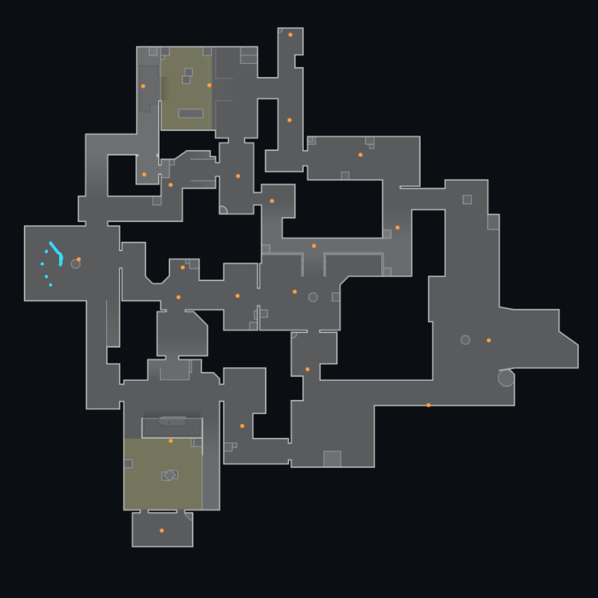

# PROJECT V — 리플레이 운동학(Kinematics) & 좌표 정합 (PV-6 2차)

**기준일:** 2026-11-18 · **담당:** PV-6 · **브랜치:** `claude/pv-replay`

PV-6 1차에서 Linux로 디코딩한 실제 `.vrf`(Ascent combat 캡처)의 **위치 궤적**을 기반으로,
① 맵 식별 ② PV-4(Spatial) 좌표 변환 검증 ③ 이동 운동학 통계를 산출한다. 산출물은
`datasets/derived/kinematics/`에 **집계값만** 저장한다(프레임 단위 궤적·원본 `.vrf`·ProfileName 미커밋).

> ⚠️ **일반화 금지 — 표본 한계:** 이 분석은 **단 1경기, 1명(actor), 짧은 캡처**(3001 샘플,
> 전체의 86.8%가 정지)에서 나왔고, 플레이어가 **디펜더 스폰 1개 구역**에만 머물렀다. 아래 수치는
> **방법론 시연 + 느슨한 사전값(prior)**이지 보정된 상수가 아니다. 완전한 5v5 Ascent 커스텀 `.vrf`가
> 필요하다(`vrf-capture-guide.md`).

재현:
```bash
# 1) PV-6 1차 파서로 decode-full.txt → raw.json (replay-parser.md §2)
# 2) 참고 입력: valorant-api 맵, PV-4 navgraph(origin/claude/pv-spatial, 읽기 전용)
node tools/replay-parser/analysis/run-analysis.mjs raw.json valapi-maps.json ascent.navgraph.json <outDir>
node tools/replay-parser/analysis/overlay.mjs <outDir>/_points.json overlay.png
```

---

## 1. 맵 식별 — **Ascent** (decoded, L3)

| 신호 | 결과 |
|---|---|
| **디코드 힌트(1순위)** | 파서 로그에 `/Game/Maps/Ascent/Ascent.Ascent_C` 액터 클래스 등장 → `mapHints={Ascent:1}`. **decoded 증거.** |
| 변환 [0,1] 포함(보조) | valorant-api 변환을 모든 샘플에 적용. **Ascent·Haven·Split 모두 frac=1** (작은 군집은 여러 맵의 [0,1]에 들어감 → 약한 신호). Ascent가 **bbox 최소(0.00225)**. |

**판단:** 디코드된 클래스 경로가 1순위 근거이고, 변환 포함 테스트가 이를 보조한다. 작은 공간
범위 때문에 포함 테스트만으로는 Ascent/Haven/Split을 못 가린다 — **힌트가 결정적**이다. (근거를
`datasets/derived/kinematics/*.json`의 `mapIdentification`에 기록.)

---

## 2. 좌표계 정합 검증 — PV-4 변환이 실제 `.vrf` 좌표에 맞는다 ✅

PV-4 `datasets/spatial/ascent/coordinate-system.json`의 축 교환형 변환
(`minimapX = gameY*xMul + xAdd`, `minimapY = gameX*yMul + yAdd`;
xMul=0.00007, yMul=−0.00007, xAdd=0.813895, yAdd=0.573242)을 **디코드된 월드 좌표에 그대로 적용**:

| 지표 | 값 |
|---|---|
| 미니맵 bbox X | [0.0706, 0.1028] |
| 미니맵 bbox Y | [0.4065, 0.4765] |
| **[0,1] 포함 비율** | **1.0000 (3001/3001)** |

→ PV-4 변환이 `.vrf` 월드 좌표를 **빠짐없이 미니맵 [0,1]에 매핑**한다. PV-4가 콜아웃으로만
검증했던 변환식이 **실데이터 궤적에서도 유효함**을 교차 확인(= PV-4 변환의 첫 실측 검증).

### 시각 검증


청록(cyan) = 투영된 실제 샘플 위치, 주황 = PV-4 콜아웃 앵커. 궤적이 **맵 내부(좌측 중앙 방) 안에서
일관된 경로**를 그리며, 맵 밖이나 무작위 산포가 아니다 → 투영이 올바름을 육안으로도 확인.
(PNG: `datasets/derived/kinematics/ascent-capture-01.overlay.png`)

### 콜아웃 할당 & 이동 시간 비교
- 3001 샘플 **전부 `defender-spawn`에 최근접**(PV-4 zone 앵커 기준). 즉 이 캡처는 **구역 간 이동이 없다.**
  → **관측 구역 간 이동 시간 비교 불가**(전이 0건). PV-4 zone 좌표 자체가 `manual-approx`임도 유의.
- 대신 PV-4 그래프의 **직선 이동 시간 예측**(참고, run 6.75 / walk 3.4 m/s):

  | 구간 | 거리 | run 예측 | walk 예측 |
  |---|---|---|---|
  | defender-spawn → a-site | 52.0 m | 7.70 s | 15.29 s |
  | defender-spawn → b-site | 48.6 m | 7.21 s | 14.30 s |
  | attacker-spawn → a-site | 90.4 m | 13.39 s | 26.59 s |
  | a-main → a-site | 20.9 m | 3.09 s | 6.14 s |

  이 예측의 **속도 상수(run 6.75 m/s)** 를 아래 §3이 실측으로 뒷받침한다 → 이동시간 모델의 **입력이 검증됨**.

---

## 3. 이동 운동학 통계 (맵 무관, 시뮬 보정용)

표본: **actor 1, 샘플 3001, step pair 2995, move segment 6, idle segment 12.** 샘플레이트
**128 Hz**(step dt ≈ 0.0078 s). 단위: 거리 uu(1 uu≈1 cm, unitsPerMeter=100), 속도 m/s, 각속도 deg/s.

### 3.1 속도 분포 & 상태 — **핵심 검증값**
| 지표 | 값 |
|---|---|
| 최고 속도 | **6.837 m/s** (683.7 uu/s) |
| p90 / p95 / p99 | 2.336 / 4.738 / 5.776 m/s |
| p50 / p75 | 0 / 0 m/s (대부분 정지) |
| 이동 중 평균 | 3.848 m/s |
| 상태 비율 | idle **86.81%**, walk/crouch 5.91%, run 7.28%, anomalous 0% |

> **🎯 검증:** 실측 최고 속도 **6.84 m/s** ≈ VALORANT 문서상 기본 달리기 **6.75 m/s** (+1.3%).
> PV-4 navgraph가 가정한 `runSpeedMetersPerSec=6.75`를 **실데이터가 뒷받침**한다. anomalous(>7.5 m/s)
> 0건 → 텔레포트/부스트 없음.

**상태 임계값(근거):** idle<0.3 m/s, walk/crouch 0.3–4.0 m/s, run 4.0–7.5 m/s, anomalous>7.5 m/s.
문서상 run 6.75 / shift-walk ~3.4 m/s 기반이나, **`.vrf`는 입력(shift/crouch)을 디코딩하지 못하므로
"속도 밴드"일 뿐 실제 입력 상태가 아니다**(walk와 crouch를 분리 불가).

### 3.2 방향 전환율 (yaw 각속도) — Combat Engine 조준/반응 입력
| 지표 | 값 |
|---|---|
| p50 / p90 / p99 | 0 / 2.56 / 85.76 deg/s |
| 최대 | 230.4 deg/s |
| 평균 | 2.9 deg/s |
표본 n=2995. 대부분 정지(각속도 0)이며, 피킹/플릭 순간에 수십~200+ deg/s의 빠른 회전이 섞인다.
Combat Engine의 **조준 전환 시간·반응 보정**의 느슨한 사전값으로 쓸 수 있다(표본 1인 한계 명시).

### 3.3 가속/감속 (move segment 기준, n=6)
| 지표 | 값 |
|---|---|
| 세그먼트 시작→최고속도(accel) 평균 | 0.388 s |
| 최고속도→정지(decel) 평균 | 0.118 s |
| 세그먼트 최고속도 p100 | 6.837 m/s |
n=6으로 매우 적어 **통계적 신뢰 낮음**. 정지→전속 가속이 대략 0.3–0.4초 규모임을 시사하는 정도.

### 3.4 구간 길이 & 첫 이동
| 지표 | 값 |
|---|---|
| move 구간 평균 | 0.514 s (p90 0.641, max 0.813) |
| idle 구간 평균 | 1.693 s (p90 2.10, max 9.01) |
| 라운드 시작→첫 이동 | **측정 불가(n=0)** — 짧은 캡처의 라운드 마커가 이동 시작과 정렬되지 않음 |

---

## 4. 개인정보 처리
- 산출물의 플레이어는 **`player_1..N` 익명 ID**로만 표기(`capture.players`). 원래 `ProfileName`은
  어떤 산출물에도 포함하지 않는다.
- grep으로 커밋물 전체에서 실명 부재를 확인(핸드오프 §검증).

## 5. PV-4 Combat Engine에 전달하는 값 (단위·정의 명확화)
- `kinematics.speed.topSpeedMps` = 6.84 m/s (실측 run 상한, uu/s 병기).
- `kinematics.speed.stateFractions` = 속도 밴드 비율(입력 상태 아님).
- `kinematics.yawRate` = deg/s, 조준 전환 사전값.
- `kinematics.acceleration.{accelSecMean,decelSecMean}` = 초 단위, 정지⇄전속 전이 proxy.
- 모든 블록에 표본 수(n) 포함. **1경기 표본이므로 보정 상수로 고정하지 말 것.**

## 6. 다음 작업
1. 완전한 5v5 Ascent `.vrf` → actor 10명·구역 간 이동 확보 → 이동시간/첫이동/상태분리 실측.
2. 무기별 이동 속도 비교(현재 1인·무기정보 `.vrf` 부재로 미수행).
3. walk/crouch 분리: 속도만으론 불가 → 자세 상태 추정(inferred, confidence) 레이어 필요.
4. 구역 간 이동 실측치 ↔ PV-4 그래프 예측 비교(전이 발생 시).
